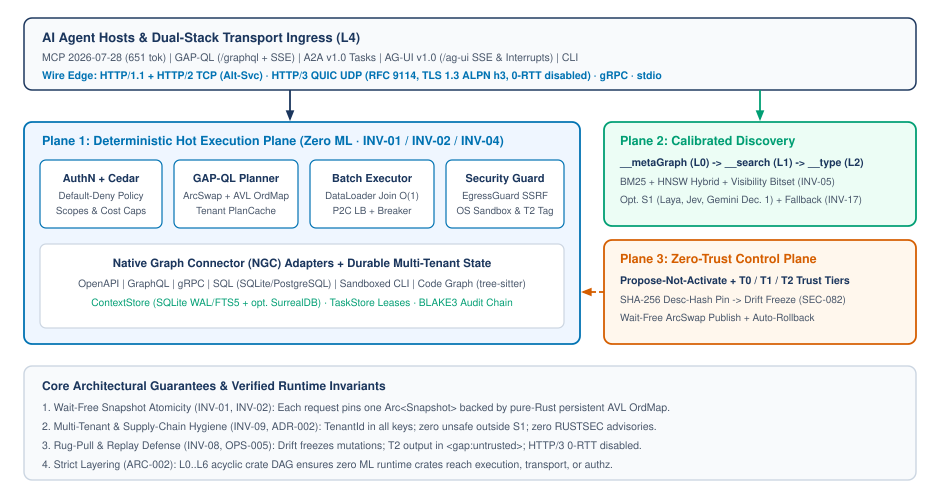
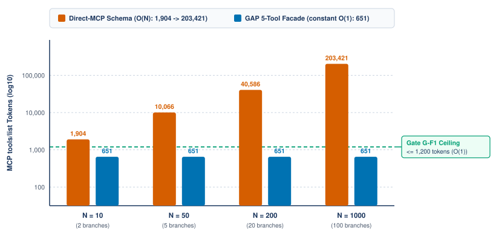
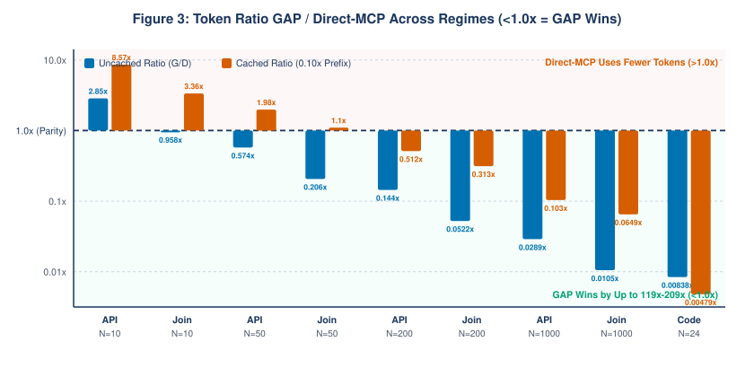
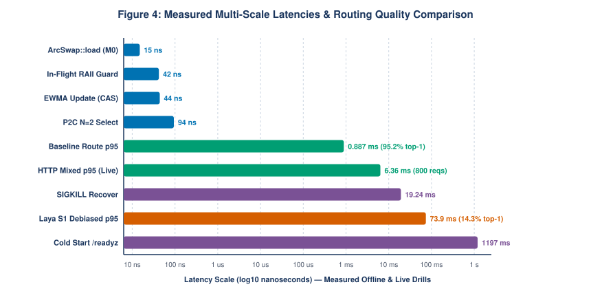

# Graph Agent Protocol (GAP): Unifying Typed Discovery, Batched Federation, and Zero-Trust Governance for AI Agents

**Author:** Mike (vnknowledge2014) (Graph Agent Protocol Project) · `vnknowledge2014@users.noreply.github.com` · ORCID pending registration
**Version / Date:** `0.1.0-rc.1` · 2026-11-16 · **Licence:** `Apache-2.0` · **Repository:** `https://github.com/vnknowledge2014/GraphProtocol`
**LaTeX Source & arXiv Bundle:** [`paper/main.tex`](../../paper/main.tex) · [`paper/references.bib`](../../paper/references.bib) · [`CITATION.cff`](../../CITATION.cff)

---

## Abstract

AI agents increasingly interact with heterogeneous backends—REST/OpenAPI services, SQL stores, GraphQL subgraphs, gRPC services, CLI executables, codebases, Model Context Protocol (MCP) tool servers, peer Agent2Agent (A2A) workers, and interactive AG-UI user interfaces. Current practice splits these capabilities across flat JSON-RPC tool catalogs (MCP), horizontal agent task endpoints (A2A), and ad-hoc frontend streams, causing $O(N)$ prompt schema inflation (`203,421` tokens at `1,000` tools), client-driven $N+1$ join waterfalls, unpinned mutable descriptions vulnerable to semantic rug pulls, and non-deterministic hot-path routing.

**Graph Agent Protocol (GAP)** resolves these problems as a unified, strongly typed GraphQL-profile gateway organized into three separated architectural planes:
1. A **Zero-ML deterministic execution plane** enforcing Cedar policies (`INV-04`), tenant-isolated query planning (`INV-09`), batched DataLoader federation (`INV-18`), and wait-free per-request snapshot pinning (`INV-01`, `INV-02`).
2. A **Three-level progressive discovery plane** (`__metaGraph` -> `__search` -> `__type`) exporting an invariant five-tool MCP `2026-07-28` facade (**`651` tokens** across `N = 10..1,000`), A2A v1.0 tasks, and AG-UI v1.0 (`/ag-ui`) SSE + approval interrupt streams alongside calibrated retrieval (`@receptron/laya`, TypeSafe `Jev`, Google `gemini-decision-1`) with transparent deterministic fallback (`INV-17`, `RTE-044`, `RTE-047`..`049`).
3. A **Zero-Trust ingestion & snapshot control plane** enforcing propose-not-activate onboarding, SHA-256 description pinning with immediate `BranchStatus::Drift` freeze against rug pulls (`SEC-082`, `INV-08`), DNS-pinned egress SSRF defense (`SEC-075`), sandboxed execution (`SEC-070`), and BLAKE3 hash-chained audit logs (`INV-10`, `SEC-092`).

Implemented across **32 layered Rust crates** (`Edition 2024`, toolchain `1.98.1`) with zero `RUSTSEC` advisories, GAP cuts cross-branch token usage at `N = 1,000` by **99.0%** uncached (**93.5%** cached) and reduces code-graph context by **119.3x–208.7x**, while quantifying the exact crossover regimes (`N <= 50` cached flat RPC) where Direct-MCP retains an advantage. Measured locally on the bit-reproducible `26.9 MB` (`26,902,360 B`) release binary over dual-stack `HTTP/1.1+HTTP/2` TCP and `HTTP/3` QUIC (`RFC 9114`, `0-RTT` disabled per `OPS-005`), GAP cold-starts in **`313.98 ms`** at **`9.24 MiB`** idle RSS, sustains **`2,227.6 req/s`** mixed TCP load (`5.11 ms` p95, `0` errors) and **`7,869.5 req/s`** multiplexed QUIC load (`1.452 ms` p95, `0` errors), and recovers from OS `SIGKILL` (`kill -9`) in **`12.96 ms`**.

---

## 1. Introduction & Structural Gaps in Existing Agent Protocols

Two valuable open standards organize parts of today's agent ecosystem: Anthropic's **Model Context Protocol (MCP)** connects models to vertical tools/data via JSON-RPC, while Google's **Agent2Agent (A2A)** delegates horizontal asynchronous workflows across peer agents. Yet four architectural weaknesses emerge at multi-tenant production scale:

1. **Linear Context Growth (`O(N)`):** Direct-MCP serializes flat JSON Schema catalogs into prompts upfront (`1,904` tokens at `N=10` -> `203,421` tokens at `N=1,000`).
2. **Client-Side $N+1$ Joins:** Without a server-side query planner, cross-backend relationships force repeated LLM round-trips across APIs, databases, and repositories.
3. **Unpinned Descriptors & Semantic Attacks:** Recent security literature (`arXiv:2506.02040`, `arXiv:2508.14925`, `arXiv:2512.06556`) demonstrates how mutable tool descriptions permit tool poisoning and post-approval MCP rug pulls.
4. **Hot-Path ML Entanglement:** Routing typed requests through neural classifiers inside every call adds latency and weakens formal authorization guarantees.

GAP separates deterministic execution from calibrated discovery so security, isolation, and typed joins never depend on probabilistic inference (`ARC-002`, `INV-04`, `INV-17`).

---

## 2. Three-Plane Architecture, Trust Tiers, and Invariants

Every external backend (*branch*) carries an explicit trust tier:
- **`T0` (Signed Internal Platform):** Ed25519 `branch.manifest.json` verified against `trust.org_keys[]` (`SEC-060`); verification failure downgrades automatically to `T2`.
- **`T1` (Admin-Approved):** Vetted branches with cryptographically pinned schema (`spec_hash`) and sanitized description digests (`desc_hash`, `SEC-061`).
- **`T2` (Untrusted / External):** Default tier for unverified sources; outputs are length-capped, scrubbed, and isolated inside escaped `<gap:untrusted source="...">...</gap:untrusted>` tags (`SEC-080`, `CMP-007`), while process launches fail closed without OS sandbox support (`SEC-071`).

GAP continuously verifies **20 normative architectural invariants (`INV-01`..`INV-20`)** and **17 security threat controls (`TM-01`..`TM-12`, `TM-15`..`TM-18`, `TM-20`..`TM-22`)** defined across `spec/01-architecture.md` and `spec/07-security.md`, backed by automated static checks (`tools/check_layers.py`) and strict test traceability (`tools/spec_trace.py --strict`: `362` requirements, `89` MUST, `0` uncovered, `2,511` markers).

---

## 3. Protocol Design: GAP-QL, Progressive Disclosure, and Federation

- **Strict GraphQL Profile (`ADR-001`, `GQL-001`):** Parsed cleanly by `apollo-compiler` without non-standard keywords (`__metaGraph`, `__search`, `__type`, `@sideEffect`, `@requiresScope`, `@join`).
- **Three-Axis Open Agent Stack (`CMP-008`, `CMP-025`..`028`):** Vertical tools (`gap_search`, `gap_describe`, `gap_query`, `gap_mutate`, `gap_task`, holding `tools/list` at **`651` tokens** under MCP `2026-07-28`), horizontal peer workflows (A2A `v1.0`), and frontend SSE event/state/interrupt streaming (`AG-UI v1.0` at `/ag-ui`, mapping Cedar/mutation approvals to `RUN_FINISHED` interrupts and spotlighting `T2` outputs inside escaped `<gap:untrusted>` envelopes).
- **Multi-Provider System-1 Discovery (`ADR-028`, `RTE-047`..`049`):** Supports local ONNX/Candle (`laya`), `@receptron/laya` HTTP bridges, TypeSafe `Jev` (`/v1/systemone`), and Google `gemini-decision-1` (`/v1beta/decisions`, zero output tokens, `<= 1,000` parallel `choice`/`score`/`noul` questions), guarded by `EgressGuard`, `Secret<T>` redaction (`INV-15`), and automatic `BaselineRouter` fallback (`INV-17`).
- **Native Graph Connectors (`NGC-001`) & Batched Joins (`INV-18`):** Connectors expose uniform `Describe`, `BatchQuery`, `Mutate`, `StreamEvents`, and `Ping` contracts. Ingestion requires data-verified join containment checks (`ADR-012`), and runtime executors deduplicate join keys deterministically to dispatch $O(\lceil U / B \rceil)$ upstream frames.
- **Dual-Stack HTTP/2 + HTTP/3 over QUIC (`ADR-026`, `OPS-005`):** `gap-transport` serves `/graphql`, `/graphql/stream` (SSE), `/mcp`, and health routes concurrently over TCP (`HTTP/1.1` + `HTTP/2` with `Alt-Svc: h3=":<port>"; ma=86400`) and UDP QUIC (`HTTP/3`, RFC 9114, TLS 1.3 ALPN `h3` via `quinn` + `h3`). TLS 1.3 `0-RTT` early data is explicitly disabled (`max_early_data_size = 0`) to stop mutation replay, and `profile = "prod"` fails closed if `http3_listen` lacks explicit cert/key secrets.
- **Durable A2A Tasks (`ADR-016`, `RUN-091`):** Supports the 8-state asynchronous task lifecycle with persistent SQLite leases and peer delegation hop counters preventing cycles (`INV-20`).

---

## 4. Zero-Trust Governance & Wait-Free Snapshot Control

- **Cedar Deterministic Authz (`INV-04`):** Evaluates `(principal, action, resource, context)` before connector dispatch; untrusted downstream hints (`readOnlyHint`) never relax `@sideEffect(level)` gating.
- **Rug-Pull Drift Freeze (`SEC-082`, `INV-08`):** `DriftMonitor` re-hashes sanitized upstream `Describe` responses; breaking schema shifts or tampered descriptions freeze the branch into `BranchStatus::Drift` while planners serve exclusively the pinned baseline.
- **SSRF & Sandbox Defense (`SEC-070`, `SEC-075`):** `EgressGuard` pins resolved DNS IPs, blocks loopback/private/CGNAT/cloud metadata (`169.254.169.254`), obfuscated numeric IPs, and userinfo URLs across redirects; local binaries require SHA-256 allowlists inside OS sandboxes.
- **Wait-Free Swap & Rollback (`INV-01`, `INV-02`, `ADR-009`):** `SnapshotHandle` publishes compiled generations atomically via `ArcSwap` (zero locks on readers; reclamation offloaded from the swapper thread) guarded by `RollbackWatcher` and BLAKE3 tamper-evident audit chains (`INV-10`, W3C PROV-O export).

---

## 5. Reference Implementation & Verification Matrix

- **32 Layered Rust Crates (`L0`–`L6`):** Pure-Rust `protox` codegen (`gap-proto`), SQLite durability with online `backup_to`/`restore_from` (`gap-store`), optional non-BSL-contaminating `store-surreal` isolation (`ADR-020`), owned zero-`unsafe` persistent AVL `OrdMap` snapshot maps (`gap-core`) + direct `rustls-pki-types` PEM parsing (`gap-transport`), 6 native connectors (`OpenAPI`, `GraphQL`, `gRPC`, `SQL`, `CLI`, `tree-sitter` `Code`), inbound `gap-mcp` / `gap-a2a` / `gap-agui`, multi-provider `gap-s1` (`Candle`, `Laya`, `Jev`, `gemini-decision-1`), and the `gap` binary (`15` operational commands).
- **Offline Hardening Results:**
  - `cargo fmt --check`, `cargo clippy --workspace --all-targets --offline -- -D warnings`, `RUSTDOCFLAGS="-D warnings" cargo doc --workspace`, and `cargo deny --offline check advisories bans licenses sources` all pass (`0` warnings, `0` `RUSTSEC` advisories with `ignore = []`, `0` BSL packages in CycloneDX 1.5 SBOM of `437` components).
  - Conformance: **`135 / 136`** local tests pass (`133` batch + `2` loopback HTTP socket NGC kits; `1` differential test awaits external `node` + `graphql` 16.x).
  - Property & Resilience: `365/365` proptests (`1,024` cases across `9` crates), `10` fuzz harnesses seeded (`34` inputs), `3/3` upgrade/backup-restore drills, `4/4` chaos scenarios, `4/4` soak/shutdown/rug-pull scenarios.

---

## 6. Empirical Evaluation

### 6.1 Discovery Scaling (`GQL-022` Estimator)

| `N` Tools | Branches | GAP `tools/list` (tokens) | Direct-MCP `tools/list` (tokens) | `__search` Recall@10 | `__search` p95 (ms) |
|---:|---:|---:|---:|---:|---:|
| 10 | 2 | **651** | 1,904 | 1.0000 | 0.413 |
| 50 | 5 | **651** | 10,066 | 1.0000 | 0.553 |
| 200 | 20 | **651** | 40,586 | 1.0000 | 0.928 |
| 1,000 | 100 | **651** | 203,421 | 1.0000 | 3.618 |

### 6.2 End-to-End Token Efficiency & The Crossover Law

| Suite | `N` | Direct Uncached | GAP Uncached | Ratio (U) | Direct Cached | GAP Cached | Ratio (C) | Turns (D/G) |
|---|---:|---:|---:|---:|---:|---:|---:|---:|
| `api_lookup` | 10 | 2,041.6 | 5,823.0 | 2.852x | 547.2 | 4,691.9 | 8.575x | 1.0 / 2.0 |
| `api_lookup` | 50 | 10,205.5 | 5,859.5 | **0.574x** | 2,385.2 | 4,728.0 | 1.982x | 1.0 / 2.0 |
| `api_lookup` | 200 | 40,724.3 | 5,865.5 | **0.144x** | 9,251.2 | 4,734.9 | **0.512x** | 1.0 / 2.0 |
| `api_lookup` | 1,000 | 203,559.5 | 5,878.0 | **0.029x** | 45,889.1 | 4,747.0 | **0.103x** | 1.0 / 2.0 |
| `cross_branch_join` | 10 | 8,891.8 | 8,517.9 | **0.958x** | 2,200.5 | 7,383.7 | 3.355x | 4.0 / 2.0 |
| `cross_branch_join` | 50 | 41,539.8 | 8,547.9 | **0.206x** | 6,740.7 | 7,413.7 | 1.100x | 4.0 / 2.0 |
| `cross_branch_join` | 200 | 163,619.8 | 8,547.9 | **0.052x** | 23,717.4 | 7,413.7 | **0.313x** | 4.0 / 2.0 |
| `cross_branch_join` | 1,000 | 814,959.8 | 8,547.9 | **0.010x** | 114,294.4 | 7,413.7 | **0.065x** | 4.0 / 2.0 |
| `code_graph` | 24 | 141,681.3 | 1,187.4 | **0.008x** | 137,810.4 | 660.4 | **0.005x** | 11.0 / 1.0 |

- **Crossover Analysis (`ADR-017`, `ADR-021`):** Direct-MCP outperforms GAP on tiny cached catalogs (`N=10`: `547.2` vs `4,691.9` tokens) and cache-warm flat lookup at `N=50`. Once catalogs cross `N >= 60`–`200`—or immediately on graph queries (`119.32x` uncached / `208.68x` cached on 24 symbols)—GAP dominates cleanly. Similarly, `GAP-Bench` measured `< 20%` end-to-end token savings from `@format(as: COLUMNAR)` (`GQL-003`), leading us to defer wire columnar syntax for `1.0-RC` ([`x1-columnar.md`](../decisions/x1-columnar.md)).

### 6.3 System-1 Routing (`RouteBench`) & Multi-Scale Runtime Latencies

| Metric / Component | Measured Value | Source Artifact |
|---|---|---|
| Deterministic `baseline` Router (`RouteBench` Test / Held-out) | **0.9524** / **0.9722** top-1 @ **`0.887 ms`** p95 | `bench/results/routebench/s1_comparison/s1_comparison.json` |
| Shipped `laya-candle:f32` (`s1_forward` / `s1_debiased`) | `0.0714` / `0.1429` top-1 (`ECE = 0.0303`) @ `42.3`–`73.9 ms` p95 | `bench/results/routebench/s1_comparison/s1_comparison.json` |
| `ArcSwap::load` / `ArcSwap::store` (256 readers) | **`15 ns`** / **`22.8 us`** p50 (`59 us` p99) | `docs/00-REVIEW.md` (`docs/evidence/arcswap-bench/`) |
| Lock-Free `in_flight` / CAS EWMA / P2C `N=2` (`net.p50`) | **`42 ns`** / **`44 ns`** / **`94 ns`** | `bench/results/perf/m3-baseline.json` |
| Reproducible Binary Parity (`--offline --locked`) | `26,902,360` bytes (`26.9 MB`), identical SHA-256 (`62224cb5...89d308acf`) | `bench/results/ga_local/report.json` |
| Live Cold Start / Idle RSS / Post-Load RSS (`gap serve`) | **`313.98 ms`** / **`9.24 MiB`** / **`15.75 MiB`** | `bench/results/ga_local/report.json` |
| Live TCP Mixed Load (`800` reqs, `8` threads, `urllib` -> subprocesses) | **`2,227.6 req/s`**, `0` errors, **`5.11 ms`** p95 (`7.173 ms` p99) | `bench/results/ga_local/report.json` |
| Live HTTP/3 QUIC Load (`8` mux conns, `800` reqs, `0-RTT` off, in-process fixtures) | **`7,869.5 req/s`**, `0` errors, **`1.452 ms`** p95 (`1.62 ms` p99) | `bench/results/ga_local/report.json` |
| OS `SIGKILL` (`kill -9`) Crash Recovery to `/readyz` `200 OK` | **`12.96 ms`** (clean `SIGTERM` exit `0`) | `bench/results/ga_local/report.json` |

---

## 7. Related Work & Positioning

GAP synthesizes lessons across tool-use LLMs (Gorilla `arXiv:2305.15334`, ToolLLM `arXiv:2307.16789`), protocol standards (Anthropic MCP `2026-07-28`, Google A2A `arXiv:2504.16902`), empirical MCP security audits (`arXiv:2506.02040`, *MCPTox* `arXiv:2508.14925`, `arXiv:2512.06556`), progressive GraphQL-over-MCP servers (Apollo MCP Server, Grafbase), GraphQL formal complexity (Hartig & Perez, WWW '18), formally verified authorization engines (Cedar `arXiv:2403.04651`, OOPSLA '24), and distribution-free conformal calibration (Angelopoulos & Bates `arXiv:2107.07511`). Whereas prior systems address discovery, joins, authorization, or agent delegation piecemeal, GAP unifies all four behind strict zero-ML execution invariants and machine-verifiable conformance contracts.

---

## 8. Limitations & Reproducibility

Connected Linux staging runs remain queued to transition final cloud gates (`72 h` soak, `24 h` libFuzzer + `ASan`/`TSan`/`miri`, live Docker daemon container verification, OIDC `cosign`/SLSA tagging, live multi-provider LLM `GAP-Bench` evaluations, and `promtool` Alertmanager staging tests — documented cleanly in [`dist/run-linux-ga-gates.sh`](../../dist/run-linux-ga-gates.sh) and [`docs/gates/RC.md`](../gates/RC.md)). Locally, HTTP/2 (`urllib` short-lived connections to separate OS subprocesses) and HTTP/3 (persistent multiplexed QUIC connections to in-process fixtures) drills measure distinct transport topologies reported transparently above. Every local result, raw JSON transcript, LaTeX source (`paper/main.tex`), and figure generator (`paper/scripts/generate_figures.py`) is immediately reproducible offline from this repository.
