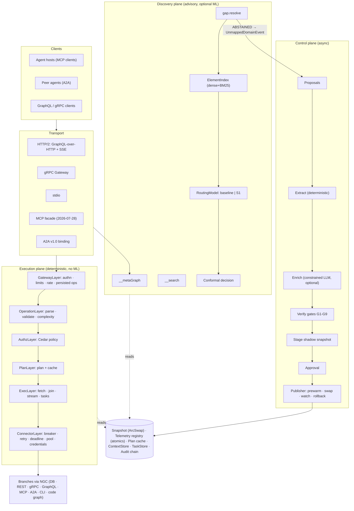

# GAP Specification — 01 Architecture

Normative IDs `ARC-*`. Rationale: ADR-003, 009, 018, 022.

## 1. Goals and non-goals
**Goals.** One typed, introspectable, token-efficient surface through which an AI agent can (a) discover what exists with progressive disclosure, (b) execute reads/writes across heterogeneous backends with batched joins and no N+1, (c) traverse code/doc/context graphs, (d) delegate long-running work to peer agents, all under deterministic authorization, with live adaptation of the supergraph and no downtime.
**Non-goals (1.0).** See ADR-019. GAP is not a database, not a workflow engine (Tasks are thin), not an LLM gateway, and does not make authorization decisions with a model.

## 2. System overview


## 3. Crates and layering
Crates are introduced by the milestone that needs them (see `docs/02-PLAN.md`). **Layer rule:** a crate MAY depend only on crates in strictly lower layers (and on third-party crates allowed by `deny.toml`). `tools/check_layers.py` enforces this from `cargo metadata` (WP-M0-05).

| Layer | Crates | May depend on |
|---|---|---|
| L0 | `gap-core` (ids, errors, config, `Snapshot` data model, shared traits `ElementSearch`, `Embedder`, `DiscoveryService`, `GraphqlEngine`, `HttpModule`) | third-party only |
| L1 | `gap-proto`, `gap-ql`, `gap-index` (BM25/vector/fusion — **no ML**), `gap-store`, `gap-sec`, `gap-balance` (telemetry/breaker/P2C — **no ML**), `gap-models` (model manager + embedding backends — ML allowed) | L0 |
| L2 | `gap-route` (discovery plane), `gap-plan`, `gap-ingest`, `gap-ngc-sdk` | L0–L1 |
| L3 | `gap-snapshot`, `gap-exec`, `gap-s1` (Laya backends) | L0–L2 |
| L4 | `gap-transport`, `adapters/*` (`gap-mcp`, `gap-a2a`, `gap-ngc-openapi`, `-grpc`, `-graphql`, `-sql`, `-cli`, `-code`) | L0–L3 |
| L5 | `gap-server`, `gap-conformance` (black-box), `bench/*` binaries (`routebench`, `gapbench`, `enrichment-bench`) | L0–L4 |
| L6 | `gap-cli` (the `gap` front-end: embeds `gap-server` for `gap serve`, reads the shared `gap.toml` model of `gap-core`) | L0–L5 |

- **ARC-001** The layer rule MUST hold; violations fail CI.
- **ARC-002** `gap-exec`, `gap-plan`, `gap-transport`, `gap-snapshot` and `gap-balance` MUST NOT depend (directly or transitively) on `gap-s1`, `gap-route`, `gap-models` or any ML runtime crate (`candle-*`, `ort`, `tokenizers`, `fastembed`). `gap-route` and `gap-s1` reach models only through traits; concrete backends are wired in `gap-server`. (ADR-003)
- **ARC-007** Collaboration *upward* across layers happens through traits declared in the lower crate and implemented/injected at `gap-server`: ingest → exec (`PlanReplayer`, `ShadowExecutor` implemented in `gap-exec`), snapshot → embeddings (`Embedder` from `gap-core`, implemented in `gap-models`), exec/transport → discovery (`DiscoveryService`), server → facades (`HttpModule`). Facade crates (`gap-mcp` inbound, `gap-a2a` inbound) implement `HttpModule` and are mounted by `gap-server`; they MUST NOT depend on `gap-transport` except as a dev-dependency (same layer).
- **ARC-003** Every crate has `#![forbid(unsafe_code)]` except `gap-s1` (ADR-002) and carries `#![deny(clippy::unwrap_used, clippy::expect_used, clippy::panic, clippy::todo, clippy::unimplemented)]` for non-test code.
- **ARC-004** Public items have rustdoc; `cargo doc -D warnings` passes; public API of L0–L1 crates is guarded by `cargo-semver-checks` from 0.2.0.

## 4. Core data model (Rust sketch — normative shapes, not exact code)
```rust
pub struct Snapshot {
    pub generation: u64,                       // monotonic
    pub format_version: u32,                   // ADR-024
    pub tenant_id: TenantId,                   // one Snapshot per tenant (shared structurally when identical)
    pub branches: im::OrdMap<BranchUid, Arc<BranchDescriptor>>,
    pub groups: im::OrdMap<GroupId, Arc<CapabilityGroup>>,
    pub schema: Arc<apollo_compiler::Schema>,  // composed supergraph SDL (validated)
    pub joins: Arc<JoinGraph>,                 // only ACTIVE joins participate in planning
    pub index: Arc<ElementIndex>,              // discovery (ADR-010); embedding_model_id pinned inside
    pub policy_version: u64,
    pub calibration: Option<Arc<CalibrationTable>>,   // ADR-008
    pub branch_set_hash: [u8; 32],             // part of plan-cache key (ADR-009)
    pub built_at: Timestamp, pub built_by: BuildProvenance,
}

pub struct BranchDescriptor {
    pub uid: BranchUid, pub id: BranchId, pub protocol: Protocol, pub trust: TrustTier,
    pub endpoint: Endpoint, pub spec_hash: [u8; 32], pub pinned_desc_hash: [u8; 32],
    pub capabilities: Capabilities, pub limits: BranchLimits,   // max_batch, max_in_flight, timeouts
    pub synopsis: String,                                       // <= 24 model tokens, L0 only
    pub operations: Vec<Arc<OperationDescriptor>>, pub status: BranchStatus, // ACTIVE|DRIFT|QUARANTINED|DISABLED
}

pub struct OperationDescriptor {
    pub id: OperationId, pub group: GroupId, pub kind: OpKind,       // QUERY|MUTATION|SUBSCRIPTION|TASK
    pub side_effect: SideEffect, pub idempotent: bool, pub cost: CostHint,
    pub desc_hash: [u8; 32], pub sdl: Arc<str>, pub examples: Vec<Example>,
}

/// Live state; NOT part of Snapshot (ADR-009 §7). Dense slab indexed by BranchSlot, registry maps BranchUid -> slot.
pub struct TelemetrySlot { /* see spec/04-routing.md §7 */ }

pub struct RequestContext {
    pub request_id: Uuid, pub tenant: TenantId, pub principal: Principal,
    pub deadline: Instant, pub budget: Budget, pub trace: TraceCtx, pub hop: u8,
    pub idempotency_key: Option<IdempotencyKey>, pub snapshot: Arc<Snapshot>,   // pinned, ARC-010
}
```
- **ARC-005** `Snapshot` is immutable after construction; all fields are `Arc`/persistent structures so a new generation shares unchanged branches (ADR-009 §4).
- **ARC-006** `TelemetrySlot` data MUST live outside `Snapshot`; telemetry updates MUST NOT allocate and MUST NOT trigger snapshot builds (INV-10).

## 5. Request lifecycles
**5.1 Typed execution.** (1) transport decodes → `RequestContext` with a pinned snapshot (`ArcSwap::load_full`) → (2) authn → (3) parse/validate against `snapshot.schema` (+ persisted-operation lookup) → (4) complexity/cost check → (5) authorization (per field/op, default deny; produces `AuthzDecision` set) → (6) plan (cache lookup by key in ADR-009 §6) → (7) execute (fetch nodes, joins, streaming) with per-branch breaker/retry/deadline → (8) assemble response with `extensions.gap.{generation,cost,partial}` → (9) audit/metrics/trace. No ML is invoked.
**5.2 Discovery.** `__metaGraph` / `__search` / `gap.resolve`: visibility filter (policy) → candidate generation (hybrid index) → grouping → rank (baseline or S1) → conformal decision → response `Resolution`. On `ABSTAINED`, emit deduplicated `UnmappedDomainEvent` to the control plane (RTE-040). Never executes.
**5.3 Evolution.** Proposal → extract → enrich → verify → stage (shadow `Snapshot`, shadow-traffic canary for joins) → approval (policy) → publish (prewarm → swap → reclaim) → watch 60 s → STABLE or rollback (ADR-009).

## 6. Invariants (each MUST have an automated test named `inv_<nn>_*`)
| ID | Invariant |
|---|---|
| INV-01 | A request observes exactly one snapshot generation from authn to response. |
| INV-02 | No `Mutex`/`RwLock` guard is held across `.await`; the request read path takes no lock (snapshot/telemetry/plan-cache reads are wait-free or sharded lock-free). |
| INV-03 | The execution plane has no ML dependency (ARC-002). |
| INV-04 | Authorization is a pure function of `(principal, action, resource, context, policy_version)`; no model output influences it. |
| INV-05 | Discovery results contain only elements the caller may see; filtering happens before ranking and before counting `tokensEstimate`/set sizes. |
| INV-06 | No join with status ≠ ACTIVE participates in planning. |
| INV-07 | T2 branches execute only sandboxed and only when policy permits; they never join across trust domains. |
| INV-08 | Descriptions/schemas served to agents equal the pinned `desc_hash` content; drift never reaches an agent before re-approval. |
| INV-09 | Every cache key, telemetry key, store row, audit record and metric label set that can contain tenant data includes the tenant (ADR-018). |
| INV-10 | Telemetry updates never rebuild or republish a snapshot. |
| INV-11 | A mutation reaches a connector only after the approval/side-effect policy passed (ADR-015). |
| INV-12 | Every connector call carries `deadline ≤ request.deadline − margin` and is cancelled when the request is cancelled/finished. |
| INV-13 | Task state transitions follow the FSM and are persisted before they are acknowledged or emitted. |
| INV-14 | Every mutation, approval decision, ingestion activation, policy change appends to the hash-chained audit log. |
| INV-15 | Secrets never appear in snapshots, logs, traces, metrics, error messages or model inputs. |
| INV-16 | Publishing a snapshot never blocks request threads for > 1 ms; old generations are dropped off-thread. |
| INV-17 | With S1 disabled (or failing) all non-discovery features are unaffected and discovery falls back to the baseline router. |
| INV-18 | A join node issues at most `⌈unique_keys / max_batch⌉` RHS calls (no N+1). |
| INV-19 | Cross-tenant data access is impossible through the public store/cache APIs (type-level `TenantScope`). |
| INV-20 | Hop count strictly increases along peer-to-peer GAP forwarding and requests with `hop > max_hops` (default 4) or repeated node id in `trace.path` are rejected (`GAP_LOOP_DETECTED`). |

## 7. Concurrency model
- **ARC-010** Tokio multi-thread runtime for I/O. CPU-heavy or blocking work (ML inference, embedding, parsing large specs, SQLite) runs on dedicated bounded pools (`rayon`-style or `spawn_blocking` with semaphore) so request I/O threads never starve; queue depth and rejection are metered (`gap_blocking_queue_depth`).
- **ARC-011** All channels on the request path are bounded; overflow ⇒ load shedding with `GAP_OVERLOADED` (RUN-050), never unbounded growth.
- **ARC-012** Cancellation safety: every `async fn` holding resources uses RAII guards (`InFlightGuard`, permit drops) so dropped futures release counters/permits.

## 8. Performance budget summary (details in owning specs)
| Item | Kind | Value | Owner |
|---|---|---|---|
| Typed path overhead (gateway→connector call start, p99) | SLO | ≤ 5 ms (warm plan cache), ≤ 25 ms (cold plan) | RUN |
| Snapshot swap p99 @256 busy readers | SLO | ≤ 250 µs | ADR-009 |
| Discovery retrieval-only p95 | SLO | ≤ 40 ms | RTE |
| Discovery with S1, p95 | SLO | ≤ 250 ms CPU / ≤ 80 ms GPU-Metal | RTE |
| `__metaGraph` size for ≤ 50 branches | Target → Gate at M2 | ≤ 500 tokens | RTE/GAP-Bench |
| Memory: server without S1 (10 branches, 5k operations) | Target → Gate at M2 | ≤ 600 MB RSS | OPS |
| Memory: with S1 f16 + embedder | Target → Gate at M5 | ≤ 2.0 GB RSS | RTE |
| Cold start (no S1) to ready | Target → Gate at M3 | ≤ 2 s | OPS |

## 9. Repository layout (normative for agents)
```
Cargo.toml  rust-toolchain.toml  deny.toml  clippy.toml  rustfmt.toml  Cargo.lock
crates/<gap-*>/   adapters/<gap-*>/   sdks/{typescript,python}/
proto/gap/{ngc,gateway}/v1/*.proto   conformance/<class>/*.json
spec/ docs/ work/ tools/ models/manifest.toml
bench/{routebench,gapbench}/  fuzz/  tests/{fixtures,e2e}/  .agent/{rules,skills}/
```
