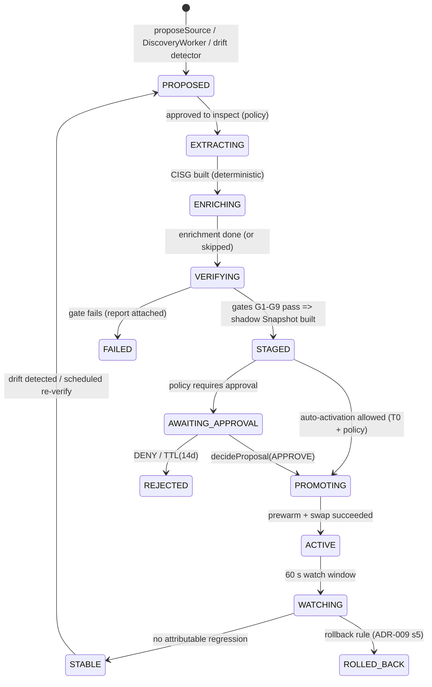

# GAP Specification — 05 Ingestion, Synthesis and Verification (control plane)

Normative IDs `ING-*`. Rationale: ADR-012, 013, 014. "System-1.5" of the earlier draft is realized as **Enricher** (optional, constrained LLM) inside a pipeline whose *trusted* parts are deterministic extraction and symbolic/data-driven verification.

## 1. Pipeline and Proposal lifecycle

- **ING-001** Every transition is persisted, audited (INV-14) and emits `gap_ingest_transitions_total{from,to}`. The *report* (JSON) lists inputs (source URL/path, `spec_hash`), tool versions, model ids, each gate result with evidence, and diffs vs. the previous generation.
- **ING-002** A Proposal is idempotent on `(tenant, location_canonical, kind)`: re-proposing returns the open Proposal.
- **ING-003** *Propose-not-activate* (ADR-013): moving from `PROPOSED` to `EXTRACTING` for any T2 source, and from `STAGED` to `PROMOTING` for any T1/T2 source, requires an explicit approval event by a principal with `admin:ingest`. T0 sources MAY auto-activate when `auto_activate_t0 = true` and the signed manifest verifies (SEC-060).

## 2. Source extractors (deterministic stage A)
All extractors implement `trait Extractor { fn kind() -> Protocol; fn extract(&self, src: &SourceHandle, limits: &ExtractLimits) -> Result<Cisg, ExtractError>; }`, are pure functions of their input bytes (+ pinned tool versions), have `ExtractLimits { max_bytes, max_depth, max_items, timeout }`, and each has a fuzz target (`fuzz_extract_<kind>`).

| Kind | Input | Output specifics | Security notes |
|---|---|---|---|
| OpenAPI 3.0/3.1 (+ Swagger 2 via conversion) | URL (SSRF-guarded) or file | operations = path×method; params→args; request/response schemas→types; `operationId` or synthesized name; pagination detection (`cursor/next/limit/offset` patterns); side effect from verb (ADR-015); `servers[]` URLs recorded but **never auto-followed** | `$ref` resolved locally only; external refs rejected; size ≤ 50 MiB |
| gRPC | `.proto` files or server reflection | services/rpcs→operations; messages→types; streaming→subscription/stream | reflection only against allow-listed hosts |
| GraphQL | SDL or introspection result | root fields→operations; keep native types; detect Relay connections | depth-limited introspection |
| SQL | DDL files or `information_schema` snapshot | tables→node types; FKs→candidate joins (`evidence=FK`); unique indexes→key fields | **no data access** at extraction; connector later read-only |
| MCP server | `tools/list`, `resources/list`, `prompts/list` over spec `2026-07-28` (fallback `2025-11-25`) | tool→operation (QUERY unless classified), JSON Schema→args; resources→node categories | descriptions untrusted (ADR-014); annotations are hints; server launched only per ADR-013/SEC-070 |
| A2A agent | AgentCard (`/.well-known/agent-card.json`) | skills→TASK operations; modes/capabilities recorded | card signature verified if present |
| CLI | explicitly allow-listed binary (absolute path + sha256) with declared help subcommands | subcommands/flags→operations (UNKNOWN side effect) | runs sandboxed, no network, time/output caps; never from `$PATH` search (ADR-013) |
| Code & docs | repository path(s) | tree-sitter AST → nodes/edges (§8) | file-size and file-count caps; no code execution |

- **ING-010** Extraction MUST be reproducible: same input bytes + same extractor version ⇒ byte-identical CISG (canonical JSON, sorted). The CISG records `extractor_id`, `extractor_version`, `source_hash`.
- **ING-011** Extractors MUST NOT perform network or filesystem access beyond the `SourceHandle` (enforced by running them in a restricted worker process: no network namespace unless the kind requires fetch, in which case via the SSRF-guarded fetcher).
- **ING-012** A malformed or hostile input MUST yield `ExtractError` within `timeout`, never a panic, hang or unbounded allocation (fuzzed for ≥ 1 h per target in CI nightly; 24 h before each release).

## 3. CISG (canonical intermediate schema graph)
```rust
pub struct Cisg {
    pub source: SourceRef,                 // kind, canonical location, source_hash
    pub extractor: ExtractorInfo,          // id, version
    pub types: Vec<TypeDef>,               // objects, enums, scalars (with JSON Schema where known)
    pub operations: Vec<OperationDef>,     // see below
    pub node_categories: Vec<String>, pub edge_predicates: Vec<String>,   // for graph-ish sources
    pub keys: Vec<KeyDef>,                 // PK/unique/identifier fields
    pub candidate_joins: Vec<CandidateJoin>,  // from FKs / naming heuristics / declared relations (evidence tagged)
    pub docs: Vec<DocBlob>,                // free text, each with provenance + hash
}
pub struct OperationDef {
    pub name: String, pub kind: OpKind, pub args: Vec<ArgDef>, pub result: TypeRef,
    pub description: String,               // UNTRUSTED
    pub side_effect: SideEffect,           // derived deterministically (ADR-015), never from description
    pub idempotent: Option<bool>, pub pagination: Pagination, pub key_fields: Vec<String>,
    pub examples: Vec<Example>, pub native_ref: serde_json::Value,   // e.g. {method:"GET", path:"/v1/invoices/{id}"}
}
pub struct CandidateJoin { pub from: FieldRef, pub to: FieldRef, pub cardinality: Cardinality, pub evidence: JoinEvidence /* FK | DECLARED | NAME_TYPE | LLM */ }
```
- **ING-020** `description`/`docs` text is stored as `UntrustedText { text, sanitized, lint: Clean|Flagged(reasons), hash }`; only `sanitized` flows downstream.
- **ING-021** `candidate_joins` with `evidence = LLM` are second-class: they can only be proposed, never auto-promoted beyond VERIFIED (ADR-012).

## 4. Enricher (optional, constrained generation)
- **ING-030** `trait Enricher { async fn enrich(&self, cisg: &Cisg, ctx: &EnrichCtx) -> Result<Enrichment, EnrichError>; }`. Implementations: `NullEnricher` (deterministic heuristics only; always available), `LlmEnricher` (provider-agnostic: local Ollama/llama.cpp, any OpenAI-compatible endpoint, Anthropic; selected by `ingest.enricher.provider`).
- **ING-031** Output is constrained by grammar/JSON-Schema (`llguidance`) to: per-operation `description_rewrite` (≤ 240 chars), `examples` (≥ 3 positive, ≥ 2 negative intents), `primary_fields[]` (≤ 3), `capability_group_hint`, branch `synopsis` (≤ 24 model tokens), and `candidate_joins[]` with a rationale. The enricher can **only** add descriptive metadata and *candidates*; it cannot set trust tier, side-effect level, auth, scopes, endpoints or hashes (those fields are not in the output schema).
- **ING-032** Inputs to the LLM are sanitized, size-capped, and wrapped as data (delimited fields, never concatenated into instructions); the prompt template and its version are part of the cache key `(source_hash, enricher_id, prompt_version, model_id)`.
- **ING-033** Privacy default: `allow_cloud_enrichment = false` — only locally hosted or explicitly configured endpoints receive source content (D-006). With cloud enabled, a `redact` pass removes values/secrets/PII from docs and examples.
- **ING-034** Enrichment quality is measured, not assumed: `bench/enrichment/` contains golden specs (≥ 30 public OpenAPI/proto/SQL samples with hand-checked joins and synopses). Gate G-E1 (M4): join proposal precision ≥ 0.9 at recall ≥ 0.6 on the golden set *after* G4 verification, ≥ 0.98 precision for the VERIFIED set; synopsis human-rated usefulness ≥ 4/5 on a 20-item sample; no hallucinated operation names (0 tolerance, checked mechanically against CISG).
- **ING-035** Failure of the enricher (timeout, invalid output after 2 constrained retries, provider down) MUST NOT fail the pipeline: fall back to `NullEnricher` output and mark `enrichment=degraded` in the report; no auto-activation when degraded.

## 5. Verification gates
Gates run in order; a failure stops the pipeline with `FAILED` and a precise report. "Hard" gates cannot be overridden; "soft" gates can be acknowledged by an admin with a reason (audited).

| Gate | Check | Kind | Fail action |
|---|---|---|---|
| **G1 Schema validity** | composed supergraph SDL validates (apollo-compiler); no reserved names (GQL-004); names unique; type refs resolve | hard | FAILED |
| **G2 Type coercion** | for each join key pair: scalar types coercible (`ID/String/UUID/Int` rules in table below), nullability compatible | hard | candidate dropped |
| **G3 Key lookup** | RHS key is declared unique/PK or `uniqueness_ratio ≥ 0.999` (sketch); RHS supports batched lookup (`foreach` or `IN` predicate) | hard | candidate dropped |
| **G4 Data-driven join verification** (ADR-012) | containment ≥ 0.95, null ratio ≤ 0.5, cardinality consistent, sample ≥ 1,000 distinct values (or entire domain if smaller); sketches via NGC `Sketch` with tenant salt | hard for ACTIVE | stays PROPOSED/VERIFIED |
| **G5 Semantic plausibility** | S1/embedding similarity of field names/docs; **advisory only**, recorded in evidence | soft | none (annotation) |
| **G6 Boundedness** | every cycle in the join graph includes a `traverse`-bounded or depth-limited entry; max join fan-out per hop ≤ declared cap | hard | `GAP_CYCLE_UNBOUNDED` |
| **G7 Security lint** | description injection linter (SEC-081); no reserved/hidden Unicode; `desc_hash` computed; SSRF re-check of any URL in spec; side-effect classification complete (no op left unclassified for T0/T1 without admin ack) | hard | quarantine T2 / FAILED |
| **G8 Regression replay** | re-plan the top-N (default 200) cached/persisted operations and the conformance fixtures on the shadow snapshot; diff results of read-only ones on sampled traffic (shadow execution, results discarded) | hard if breaking, soft otherwise | FAILED or `breaking_change_ack` |
| **G9 Resource budget** | snapshot size/RSS delta within limits; build time within budget | soft | admin ack |

Coercion table (G2): `UUID↔String(format uuid)`, `Int↔Int64`, `Int↔String(numeric)` only with explicit `@join(on: {from,to, coerce: …})`, `ID↔String` allowed, `Int↔Boolean` forbidden, `Float↔Int` forbidden for keys.
- **ING-040** A join becomes `ACTIVE` only after G1–G4, G6–G8 pass and (for cross-trust or T2) approval; before that it is invisible to planning (INV-06).
- **ING-041** *Shadow canary:* a newly ACTIVE join first runs in `shadow` mode on sampled real traffic for ≥ 100 executions or 10 minutes: plans and executions run, results are compared (row counts, key coverage) against expectations from sketches; divergence beyond tolerance (coverage drop > 10 pts) reverts the join to VERIFIED and alerts. The join serves clients only after the canary passes.

## 6. Staging, approval, promotion, drift
- **ING-050** A *shadow Snapshot* is built from `current + proposal` (structural sharing, ADR-009). It is never visible to clients until promotion; admin tooling can query it via `X-Gap-Snapshot: shadow:<proposal_id>` (requires `admin:schema`).
- **ING-051** Approval policy (Cedar) examples: `T0 && signed && !breaking → auto`; `T1 → one admin`; `T2 or cross-trust join or mutation-capable → two-person rule` (configurable).
- **ING-052 Drift detection:** every `drift.interval` (default 15 min, jittered) call `Describe(known_spec_hash)`; on change compute `desc_hash` per operation and classify: **COSMETIC** (hash unchanged, e.g., ordering) → ignore; **SCHEMA_COMPATIBLE** (added optional fields/operations) → new Proposal (auto-verify, approval per policy); **SCHEMA_BREAKING** (removed/renamed field or operation, type change, new required argument, side-effect-relevant change) → Proposal with `breaking=true` and the branch enters `DRIFT`; **DESCRIPTION_CHANGE** (descriptions changed while schema same) → branch enters `DRIFT`.
- **ING-053** While a branch is in `DRIFT`, agents see the **pinned** descriptions (INV-08) and execution continues against the pinned schema only if the connector still accepts the pinned operation signatures (verified by a cheap probe); otherwise affected operations return `GAP_BRANCH_DRIFT`. Re-approval of the new version clears `DRIFT`.
- **ING-054** *Rug-pull test* (WP-M6-10): a mock MCP server that changes a tool description after approval must (a) not alter any text served to agents, (b) raise an alert, (c) create a Proposal, (d) leave audit records.
- **ING-055** Removing a branch: operations become `DEPRECATED` for one `grace` period (default 24 h) returning `GAP_BRANCH_UNAVAILABLE` with `suggestion.alternative` (if a group sibling exists), then disappear.

## 7. Discovery-triggered proposals
Handled by the `DiscoveryWorker` (RTE-100..103): coalesced `UnmappedDomainEvent`s → registry lookup (allow-list) → `Proposal(PROPOSED)` with `notes` = evidence (top groups, query hash). No execution, no network fetch of unapproved code. Admin UI/CLI: `gap proposals list|show|approve|deny`.

## 8. Code and document graph (the original motivating use case)
- **ING-060** `gap-ngc-code` indexes repositories into a `ContextStore` graph. Node types: `Repo, File, Module, Symbol(kind: function|method|struct|enum|trait|class|interface|const|type), Doc(kind: readme|adr|api|comment|markdown_section), Test, Concept`. Edge types: `DEFINES, CONTAINS, IMPORTS, CALLS, IMPLEMENTS, EXTENDS, REFERENCES, DOCUMENTS, TESTS, DEPENDS_ON, SUPERSEDES`. Each edge has `resolution: EXACT|HEURISTIC` and `confidence ∈ [0,1]`; tree-sitter-derived call edges are `HEURISTIC` unless confirmed by an importer of a precise index (SCIP/LSIF import is an optional extractor: `ingest.code.scip_paths[]`).
- **ING-061** Languages in 1.0: Rust, TypeScript/JavaScript, Python, Go, Java, Markdown. Grammar versions pinned; a parse failure of one file never aborts the run.
- **ING-062** Incremental indexing: file content hash → re-extract only changed files; deleted files tombstoned with `valid_to` (temporal graph, ADR-020); full re-index reproducible.
- **ING-063** Node summaries: each Symbol/Doc has `summary` (≤ 40 tokens; deterministic first-sentence/signature extraction; LLM summary optional via Enricher with the same constraints). `traverse(returnFields:[...])` returns slices; target (Gate G-C1 at M2): answer the benchmark question set "what calls X / what breaks if I change X / where is Y documented" with ≤ 15% of the tokens of a file-scanning baseline at ≥ equal answer accuracy.
- **ING-064** Graph store limits: ≤ 5 M nodes / 20 M edges per tenant in the default SQLite backend (documented ceiling; larger needs another backend). `traverse` is bounded by depth ≤ 16, `first` ≤ 1,000, and a per-query visited cap (default 100,000).

## 9. Isolation and resource limits
- **ING-070** Extraction/enrichment run in worker processes (`gap-ingest-worker`) with rlimits (CPU time, address space, open files), `PR_SET_NO_NEW_PRIVS` / seatbelt profile where available, no network except through the SSRF-guarded fetcher; worker crash ⇒ Proposal `FAILED` with report, never server crash.
- **ING-071** Concurrency: at most `ingest.max_concurrent` (default 2) pipelines per tenant; per-pipeline wall-clock cap 30 min (configurable); backlog metric `gap_ingest_backlog`.

## 10. Required tests
Extractor determinism (ING-010) · extractor fuzz (ING-012) · hostile-spec corpus (zip-bomb-like JSON, deep nesting, huge `$ref` chains, external refs) · enricher cannot set forbidden fields (ING-031, schema-level) · degraded fallback (ING-035) · G2 coercion table · G3/G4 on adversarial fixtures (same-type-different-entity keys, partial overlap, skewed duplicates) · canary revert (ING-041) · drift classification table (ING-052) · rug-pull scenario (ING-054) · incremental code indexing idempotence (ING-062) · rollback attribution (ADR-009) · golden-set gate G-E1 (ING-034) · token-efficiency gate G-C1 (ING-063).
